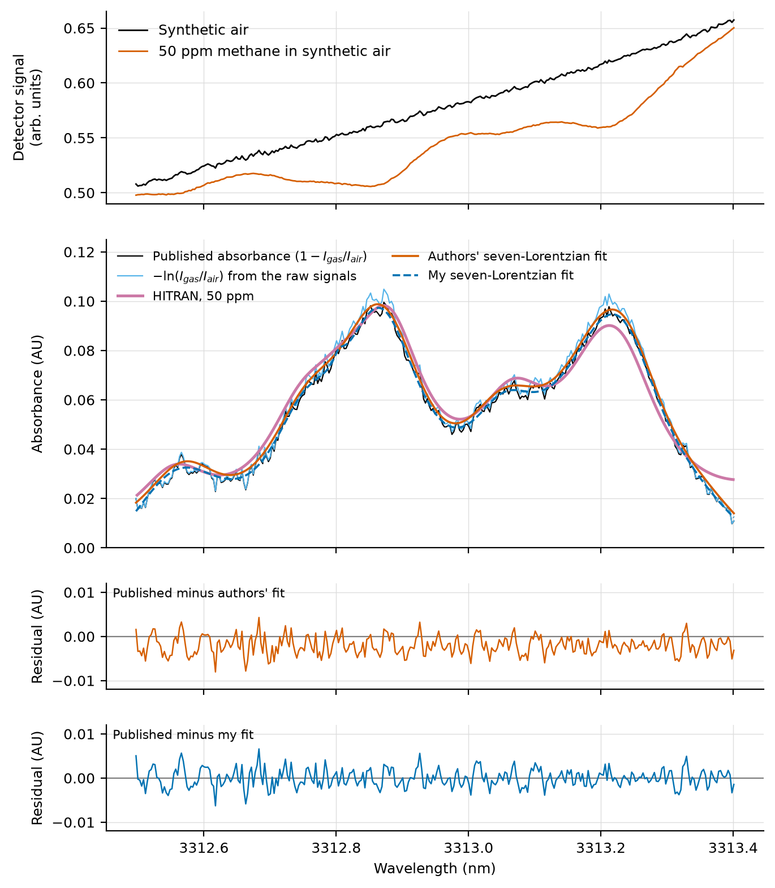
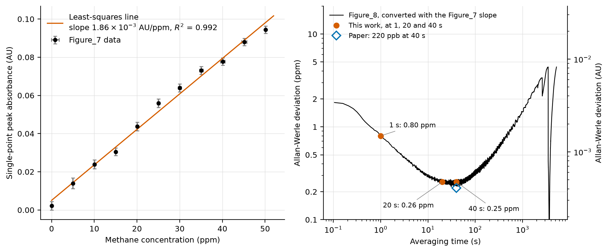
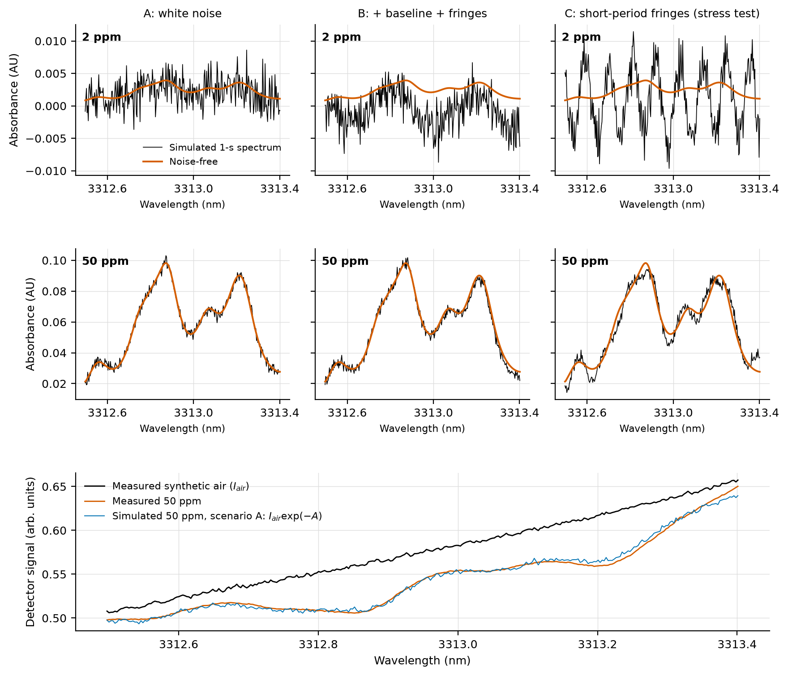
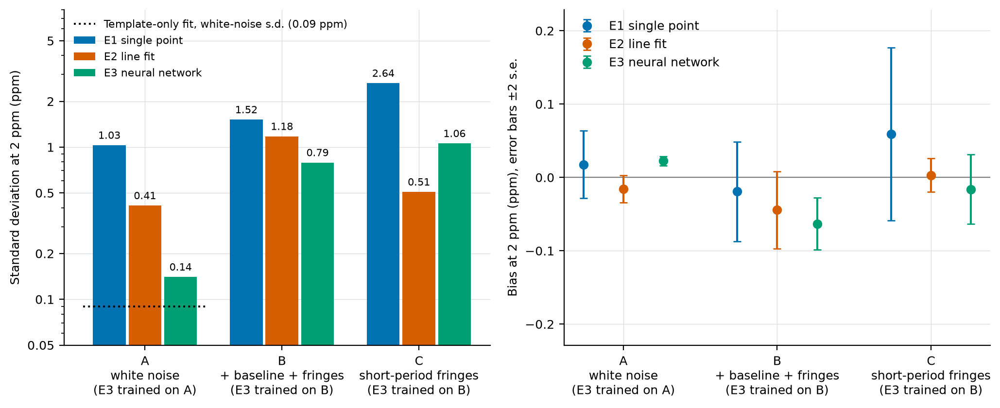

# Methane TDLAS at 3313 nm: a first look at an open dataset

A short study by Sifang Ni, Research Assistant at Cranfield University, written while learning tunable diode laser absorption spectroscopy. It reuses the open data of Davis et al. (2023): a methane sensor with an interband cascade laser at 3313 nm and a 4-inch integrating sphere. Part 1 reproduces the paper's numbers, Part 2 simulates one 1-second spectrum, and Part 3 compares three estimators. Corrections are welcome.

**Question.** What could machine learning add to a line fit for a sensor like this, and what would it need to be trained on?

## Data and attribution

Measured data: Davis et al. (2023), Cranfield Online Research Data, [doi:10.17862/cranfield.rd.22700626](https://doi.org/10.17862/cranfield.rd.22700626), [CC BY 4.0](https://creativecommons.org/licenses/by/4.0/). Seven CSV files are copied unmodified into [`data/davis2023/`](data/davis2023/README.md). The code is MIT-licensed; every number below is read from `results/*.json`.

## Part 1: reproducing the paper

| Quantity | Paper | Reproduced from open data |
|---|---|---|
| Published absorbance vs 1 − I_gas/I_air, max. difference (AU) | absorbance defined as ΔI/I₀ (Eq. 2) | 2.2e-9 |
| Published absorbance vs −ln(I_gas/I_air): correlation; mean offset (AU) | – | 0.99993; +1.99e-3 |
| Peak absorbance of the 50 ppm spectrum (AU) | used to derive the 70.1 cm pathlength | 0.0996 at 3312.87 nm |
| Figure 7 line: slope (AU/ppm); intercept (AU); R² | linear within error | 1.86e-3; 5.04e-3; 0.992 |
| Zero error (AU) | 2.2e-3 | 2.21e-3 (0 ppm row of Figure 7) |
| Single-point limit of detection (ppm) | 1.1 | 1.18 (2.2e-3 AU / Figure 7 slope); 1.10 (2.2e-3 AU / 50 ppm peak per ppm) |
| Single-point NEA, 1 s (AU) | 1.2e-3 | 1.19e-3 from the paper's noise density and bandwidth; Allan-Werle curve at 1 s: 1.49e-3 |
| Single-point NEA, 20 s (AU) | 2.7e-4 | 2.66e-4 likewise; Allan-Werle curve at 20 s: 4.74e-4 |
| Allan-Werle deviation at 40 s (AU) | 4.3e-4 | 4.73e-4; minimum over 5–200 s: 4.19e-4 at 31 s |
| Allan-Werle deviation at 40 s (ppb) | 220 | 255 (Figure 7 slope); 238 (50 ppm peak) |
| Seven-Lorentzian fit: residual s.d. (AU); curve peak (AU) | – | authors' 2.06e-3; 0.0988. Mine 2.04e-3; 0.0973 |
| Vibration test residual s.d., normal; with vibration (V) | 5.8e-4; 4.2e-4 | 5.77e-4; 4.18e-4 |





The published absorbance is exactly 1 − I_gas/I_air, the linearised ΔI/I₀ of the paper's Eq. (2), and the paper's 1.1 ppm follows from the zero error divided by the 50 ppm peak absorbance per ppm, as the text describes. My seven-Lorentzian Levenberg-Marquardt fit (seven evenly spaced starting peaks, as in the paper; a HITRAN-seeded start agrees) matches the authors' curve to 4.3e-4 AU RMS after removing their curve's 2.0e-3 AU mean offset above the data. Its individual line parameters are not physical (one negative height, baseline −0.032 AU), so I use only the fitted curve. Figure 8 of the open data is the authors' computed Allan-Werle curve, not the raw time series, so the Allan-Werle rows are read from that curve, not recomputed. Where my numbers differ a little from the paper's (for example 255 against 220 ppb), the difference comes from where a value is read off the curve and how it is converted to concentration.

## Part 2: forward model

`src/simulator.py` scales the HITRAN 50 ppm curve, interpolated onto the 317-point measured grid, by C/50, then adds white Gaussian noise of 2.0e-3 AU per point (the authors' fit residual, rounded) and, optionally, a quadratic baseline change (coefficient s.d. 2.0e-3 AU) and a sinusoidal fringe with random phase. Figure 4 also shows the raw-signal view I = I_air exp(−A).



## Part 3: single point, line fit and neural network

**E1**: absorbance at the template peak, the paper's single-point method. **E2**: linear least squares on [template, 1, x, x²], i.e. fixed line shapes and a quadratic baseline, the linear version of the paper's fit. **E3**: scikit-learn `MLPRegressor` (64 and 32 hidden units, standardised inputs, early stopping) trained on 50,000 simulated spectra, C uniform in 0–50 ppm.

Scenario **A**: white noise. **B**: plus baseline and fringes (amplitude 0–2e-3 AU, period 0.15–0.60 nm); its network is trained on exactly this. **C**, a hypothetical stress test: fringes of 6e-3 AU, period 0.05–0.12 nm (comparable to the line width), network from B. The paper reports no fringes; the sphere partly serves to avoid them. Below: 2 ppm, 2000 spectra per cell, bias standard errors 0.003 to 0.06 ppm; other concentrations are in `results/experiment.json`.

| Scenario (values in ppm) | E1 bias | E1 s.d. | E2 bias | E2 s.d. | E3 bias | E3 s.d. |
|---|---|---|---|---|---|---|
| A: white noise | +0.02 | 1.03 | -0.02 | 0.41 | +0.02 | 0.14 |
| B: + baseline + fringes (trained) | -0.02 | 1.52 | -0.04 | 1.18 | -0.06 | 0.79 |
| C: short-period fringes (not trained) | +0.06 | 2.64 | +0.00 | 0.51 | -0.02 | 1.06 |



**Consistency.** Simulated E2 s.d. is 0.98 to 1.03 times its least-squares prediction. E1 gives 1.03 ppm (paper: 1.1 ppm). E2 gives 0.41 ppm, more than double the paper's 180 ppb from 20 fits (itself about 16 % uncertain); with a constant instead of a quadratic baseline the same formula gives 0.26 ppm, or 0.19 ppm with noise at the 1-s Allan-Werle level (1.49e-3 AU).

**Real spectrum.** E1 50.7, E2 56.0, Lorentzian curve peak 49.5, network A 48.5, network B 51.7 ppm: a sanity check, not an independent validation, since the paper's pathlength came from this spectrum's peak. The template misfits it (residual s.d. 4.1e-3 AU, about twice the Lorentzian fit's), and its estimate ranges from 48.9 to 56.0 ppm depending on the number of baseline terms.

**What I take from this**

1. Under white noise the network beat the line fit (0.14 against 0.41 ppm) but not a template-only fit (0.09 ppm): its training data had no baseline change, which E2 allows for.
2. Inside its training distribution (B) the network had the smallest spread (0.79 against 1.18 ppm), exploiting baseline and fringe statistics that E2 fits freely or ignores.
3. Outside it (C) its spread was twice the fit's (1.06 against 0.51 ppm); at 50 ppm, the edge of its training range, it read low by 0.16 to 0.43 ppm.
4. The fit itself lost more to weak fringes with periods near the spacing of the absorption features (B: 1.18 ppm) than to much larger fringes with shorter periods (C: 0.51 ppm), which largely average out over the scan.
5. Training data decide what a network adds: real drift, fringes and line-shape variation would need measuring, not assuming. On the real spectrum the template-fit residual is about twice the assumed noise.

## Limits

- One real spectrum; the 180 ppb cannot be checked from the open files.
- White Gaussian noise, though the real residual is correlated (lag-1 autocorrelation 0.43); no speckle; baseline and fringe sizes assumed.
- Template fixed at 25 °C and atmospheric pressure; absorbance taken as proportional to concentration (−ln(I/I₀) is 1.053 times ΔI/I₀ at the 50 ppm peak).
- Pathlength (70.1 cm) and HITRAN curve taken from the paper.
- Small, untuned network, one seed per network.
- Simulated results say nothing about the real sensor.

## How to run

```
python -m venv .venv
source .venv/bin/activate        # Windows: .venv\Scripts\activate
pip install -r requirements.txt
python run_all.py                # rewrites results/ and figures/, prints both tables
python -m unittest -v
```

`run_all.py` took 8.9 s on a laptop; library versions are in `results/run_info.json`.

## References

- Davis N.M., Francis D., Hodgkinson J., Tatam R.P. (2023). Compact methane sensor using an integrating sphere and interband cascade laser at 3313 nm. *Sensors and Actuators B: Chemical* 389, 133866. <https://doi.org/10.1016/j.snb.2023.133866> (open access, CC BY 4.0).
- Davis N.M., Francis D., Hodgkinson J., Tatam R.P. (2023). Data supporting the article above. Cranfield Online Research Data. <https://doi.org/10.17862/cranfield.rd.22700626> (CC BY 4.0).
- Gordon I.E. et al. (2022). The HITRAN2020 molecular spectroscopic database. *Journal of Quantitative Spectroscopy and Radiative Transfer* 277, 107949. Cited by Davis et al. (2023) as the source of the HITRAN curve.
